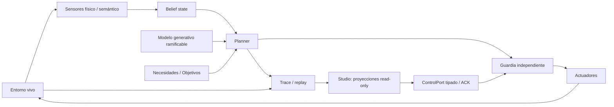

# Arquitectura funcional y contratos invariantes

Pure core: estados, transiciones, evaluación, distribuciones, actualización de creencia, semántica de IR, selección de decisiones. Functional shell: reloj, RNG explícito, IO, sensores, actuación, red, persistencia y viewer. Los algoritmos consumen un modelo que no posee referencias al entorno activo. Interfaz `GenerativeModel::step(&self, state, action, dt, rng) -> Result<Transition>`; para modelos mutables o emulados usar `BranchSession` aislada con `snapshot/restore/fork` explícitos. `LiveEnvironment::observe` y `apply(AuthorizedAction)` quedan en adaptador restringido. `Planner::plan(model, belief, objective, budget) -> PlanResult`; `Policy::authorize(proposal, current_revision, context) -> Result<AuthorizedAction>`; construir este último tipo solo en guardia. Un token no garantiza seguridad física: revalidar vigencia/precondiciones en actuador real.

## Núcleo rico, carga selectiva
`noesis-core` es la familia de capacidades oficiales, no un crate que deba contenerlo todo. Runtime, contratos, reloj, grafo reactivo y efectos son la base. Encima: información/entropía, planificación FMC, simulación y ramificación, percepción/fusión, cognición System One, creencias, motivación, memoria episódica/semántica/procedimental, aprendizaje incremental, comunicación y automatización. Implementaciones de referencia nativas utilizables por cualquier extensión. Los módulos de dominio no duplican algoritmos. Selección por plan y features de compilación cuando sean útiles; una aplicación sin IA no instancia ni requiere proveedores cognitivos. Dependencias acíclicas: capacidades dependen de contratos base; composición depende de capacidades; adaptadores y labs dependen de SDK; ninguna dependencia inversa. Comenzar con pocos crates y extraer por acoplamiento real.

System<S,I,O> expresa transición y efectos propuestos. Runtime prepara puertos tipados, orden de dependencias y recursos antes de start. Realimentación sólo por estado/delay explícito, no ciclo instantáneo. Scheduler por tick/evento; adaptativo observe-plan-act se compone como sistema, no otro runtime. Workflows locales de estados/eventos/retry acotado consumen el mismo catálogo de efectos, sin prometer durabilidad distribuida ni exactly-once externa. Los efectos externos requieren idempotencia y autorización según dominio.

Nada de ECS, Bevy, HTTP, Jev real, ROS ni Python como dependencia obligatoria. Hot loop especializado en Rust con buffers y genéricos cuando convenga. Unsafe solo en fronteras auditadas; no asumir hard RT por usar Rust. Scheduler recedente con presupuesto de transiciones para replay y deadline monotónico para ejecución real. Un planificador que no pueda interrumpir una transición no garantiza deadline: margen para guardia/actuación, candidato admisible, fallback independiente.

Distinción de datos: ground truth solo en entorno/evaluador; ObservationEnvelope con fuente, instante, frame, revision, valor, calidad y evidencia; BeliefState distribución sobre hipótesis; ModelTransition representa futuro hipotético; ProposedAction distinta de AuthorizedAction y AppliedAction. No unir estado de simulator con estado percibido por comodidad. Snapshots incluyen RNG, reloj, variables de wrapper, dinámicas y terminal; aislar fork. Control de seeds por flujo; igualdad bit a bit únicamente en plataforma/build fijados. Si un emulador no permite fork barato, procesos persistentes o modelo sustituto, medir antes de elegir.

### Extensión sin crear framework prematuro
Registry estático con manifest {id, api_version, capabilities}, factories y descubrimiento de capacidades (discreto/continuo, snapshot, batch, partial observation, semantics), sin ABI Rust dinámica. Protocolo residente para Python/emulación cuando convenga; versionar schema, batching y backpressure. WASM sandbox para plugins puros y GPU compute son posibles futuros, medir primero. SDK con conformance tests reutilizables: fork isolation, determinism, budget, error mapping y guardia. El mismo modelo genera vista read-only para Studio con eventos acotados; la UI no determina el tiempo de simulación.

### Autoría declarativa compilada
SystemSpec portable/versionado -> compilador Rust -> plan inmutable preparado -> instancias de estado. AgentSpec y ExperimentSpec componen SystemSpec, no formatos rivales. Resolver nombres, puertos, capacidades, invariantes y expresiones simbólicas tipadas en preparación; ejecución nativa sin parser ni JVM, sin callbacks Kotlin. Kotlin/JVM builders tipados como frontend oficial, DTOs generados o contrastados contra esquema Rust, JSON y Rust API equivalentes. `.noesis.kts` opcional y de confianza, no sandbox. Spec no confiable es dato con validación estricta y cuotas. Artefacto serializable `.nox` (nombre provisional) contiene versiones, hash, catálogo y plan portable, **no** punteros de proceso; revincular funciones al cargar. En MVP no generación Rust, JNI/FFI, VM general ni JIT obligatorio. Micro-evaluador de AST indexado acotado; especialización AOT solo con mediciones.

Plan compartido entre instancias; energía, creencias, memoria, genoma y objetivos autorizados son datos dinámicos. Cambios estructurales requieren nueva preparación y sustitución segura de versión, no recompilar por tick. Precedente modelo/datos: https://mujoco.readthedocs.io/en/stable/overview.html ; builders Kotlin: https://kotlinlang.org/docs/type-safe-builders.html .

### Perfiles y especialización temporal
General/Interactive/DeadlineAware iniciales; reloj lógico para replay, monotónico para deadlines. Control periódico y cognición/IO best-effort aislados; colas acotadas con overflow y caducidad explícitos. Reservar margen para guardia/actuación; fallback validado por dominio, nunca asumir stop seguro universal. Medir p99, máximo observado, jitter y misses, no confundir con WCET ni certificación. Perfil experimental Linux PREEMPT_RT y no_std solo si plataforma, cargas y pruebas concretas permiten. Evitar fallos de página, asignaciones y bloqueos imprevisibles en la ruta crítica (https://design.ros2.org/articles/realtime_background.html). Una declaración de capacidad no equivale a evidencia. En robótica: watchdog y parada física independientes, hardware fuera de MVP.

### Diseño lateral
1. Un mundo de juguete es oráculo ejecutable para todas las integraciones: no crear SDK a ciegas.
2. Counterfactual debugger: replay de snapshots y acciones alternativas, etiqueta de fidelidad y límite; no presentar predicción como hecho.
3. Sensor humano virtual: grabaciones, proveedores fake y replay son ciudadanos de primera clase. CI sin llamada comercial.
4. Experimento como dato: spec + versión + seed + métricas, mismo runner para demo/bench/CI. No otro tracker.
5. Distancia semántica o léxica no es recompensa por sí sola; aplicar métricas definidas por dominio, no generar un LLM por walker.
6. Graduar modalidades de información: acceso completo, pixel + snapshot privilegiado, observación parcial real. Evaluar cada una por separado.

### Studio transversal, no runtime alternativo
Ver documento nativo propuesto «Studio, proyecciones y experimentación observable» (NOESIS-DOC-06, alias de semilla). Proyección pura sobre snapshots; publicación acotada sólo si hay consumidores y muestreo independiente del RNG operativo. Traza científica y checkpoint distintos de frame visual. ControlPort aplica comandos autorizados en frontera con ACK/revisión; modo físico read-only por defecto. Bevy y egui viven exclusivamente en Studio. Las cámaras virtuales del agente pertenecen a percepción y se miden aparte. El mismo LabDescriptor, plan y runner sirven headless, live y replay.
