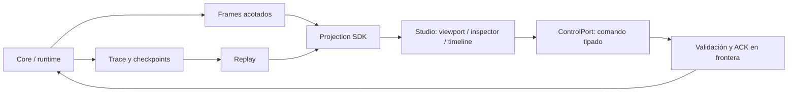

# Studio: proyección, observabilidad y experimentación científica

## Decisión propuesta

Un Studio nativo compartido, no una app por laboratorio ni un motor de videojuegos nuevo. Bevy + bevy_egui son candidatos iniciales (fijar versiones compatibles en spike, evaluar si no compilan o su coste supera valor). Rerun es referencia de vistas y timeline y exportador futuro. Runtime y SDK científico no dependen de ninguno; Bevy ECS nunca es la autoridad sobre física, creencias, walkers o estados. Sin obligar a todas las aplicaciones a tener un visor.

## Contratos de diseño (no API implementada)

- `RunId`, `EntityId` con generación o ID no reciclado, `Tick`, timestamp lógico/monotónico, `SpecRevision`, `FrameSequence`, `CoordinateFrame`, unidades y fuente. Visor soporta datos caducados y gaps. No confundir timestamp de llegada con tiempo observado.
- `ObservationPort`: snapshots visuales inmutables, con posición, campos tipados y referencias a muestras de futuras trayectorias. Cola limitada o latest-wins, cantidad de bytes y tasa de publicación negociadas; saltos explícitos. Sin observadores no proyectar ni construir muestras gráficas. Instrumentación no consume RNG del planner, usa stream separado o muestreo determinista de datos existentes. El formato de telemetría no exige serializar un mundo completo cada tick.
- `TraceSink`: eventos científicos, entradas, acciones, cambios de parámetros y revisiones, hashes/checkpoints, seed por stream, modelo/algoritmo/build, plataforma y modalidad de acceso. Cola acotada separada, disco fuera de ruta crítica. Bajo overflow, modo experimento marca incompleto o para de forma controlada; modo control continúa según política y marca gaps. Nunca vender frames perdidos como traza completa. Registro sin texto humano/secretos por defecto; acceso y cuotas explícitos. `Checkpoint` contiene estado suficiente para repetir/fork del simulador; un `VisualFrame` no tiene esa garantía.
- `Projection<Snapshot>::project` transforma datos a `Scene2D` u otra vista tipada. Primitivas comunes: línea/polilínea, círculo, rectángulo, etiqueta, transform, color semántico, ID/capa, bounding box y unidad. No crear scene graph universal para toda aplicación. Extender a textura/3D/grafos con contratos específicos cuando haya consumidor. Unidades y sistemas de referencia explícitos, conversión a píxeles solo en renderer. La proyección es pura o trabaja en estado gráfico derivado, sin acceso al entorno vivo.
- `LabDescriptor` identifica mundo, presets, capabilities y proyecciones; registro estático de factories. `ViewDescriptor` identifica tipo de vista, capas y campos; inspector por schema. Studio resuelve proyecciones, no carga código arbitrario de un `.nox`. Escape hatch gráfico sólo en Studio, no en SDK core. Reutilizar viewport, cámaras, picking, selección, gráficos, leyendas y paneles; sin duplicar lógica de dominio.
- `ControlPort`: `CommandId`, `RunId`, revisión esperada, capacidad requerida, comando (pause, step, reset, set parameter, propuesta semántica), `Ack/Rejected` con tick y revisión. Sin mutación directa de estructuras. Aplicación en frontera definida; duplicados idempotentes o rechazados. UI indica pendiente, aplicado, rechazado. Sesiones reales/remotas read-only salvo permiso explícito y guardia del dominio. Pausar/retroceder visor no congela planta física. Cerrar ventana no mata runtime por defecto. Cambios estructurales producen una nueva spec/plan; cambios dinámicos autorizados son eventos.

## Vistas comunes y significado

| Vista/capa | Origen y semántica |
|---|---|
| Entorno | Estado observado o ground truth etiquetado de evaluador; nunca entregarlo al planner por la UI |
| Percepción | Campo sensorial, alcance, frame, edad y datos faltantes |
| Creencias | Hipótesis, distribución, evidencias y contradicciones; no representar confianza como verdad |
| Imaginación | Muestras FMC con DecisionId, horizonte, modelo, recompensa y terminal, distintas de trayectoria aplicada |
| Motivación | Necesidad, utilidad, coste, presupuesto y límites; no emociones subjetivas |
| Memoria/comunicación | Episodios, proposiciones, fuente, intención, redacción y permiso |
| Control | Acción propuesta, autorizada, aplicada y resultado observado, nunca equipararlos |
| Timeline | Eventos con reloj explícito, gaps, tick seleccionado y versión |

## Proyección por laboratorio

- GridWorld: primer slice, 2D celdas/obstáculos/agente, pausa/paso/reset. CartPole: mismo viewport, fuerzas y ángulo del modelo. Racing: pista, karts, sensores y futuros; control de presupuesto por descriptor. Life: instancias/recursos, genoma y genealogía seleccionados; cálculo poblacional headless, no en GUI. Language World: parcial vs evaluador, Ask, mensajes falibles y creencias. Automation: grafo topológico del plan, transiciones/retry/acciones propuestas; funciona sin IA. Estos seis constituyen Studio MVP (distribución separada del CLI).
- Retro: emulador emite framebuffer real (homebrew libre primero), overlay en coordenadas de imagen; no reconstrucción de Mario, no ROM/Bios comercial incluida. Robotics: pose/3D o framebuffer de MuJoCo, mapas y sensores; sin segundo motor físico. Ambos optativos para MVP.
- Arena: mismo runner compara planificadores con iguales episodios, modalidades de observación y presupuestos; luego dos vistas sincronizadas por tick lógico y denominadores. No etiquetar comparación visual como benchmark ni asumir que una semilla gana siempre. Depurador contrafactual: rama desde checkpoint reproducible, modelo/seed/parent tick; predicción no hecho; deshabilitado para rewind de sistema físico.
- Playground futuro: editar escenario en modo diseño y guardar el mismo SystemSpec/ExperimentSpec; no editor universal ni un segundo modelo de datos. `VisualizationSpec` opcional: IDs de vista/capa e inspector; validación y equivalencia Kotlin/JSON; no lambdas JVM durante ejecución. Noesis Arena y Playground son modos de Studio/runner, no productos desplegados independientes.

## Presupuestos y pruebas

Separar frecuencia de simulación, control, planificación, muestreo y render. No fijar 60 FPS como contrato de control. Modo reloj virtual + presupuesto lógico permite comparación exacta bajo build/plataforma fijados; deadline real puede cambiar selección por tiempo disponible y competencia de CPU/GPU. Publicar p50/p99/máximo/misses, memoria y allocaciones en ensayos headless/visor normal/visor lento/desconectado; no confundir con WCET ni certificar hard RT. Pruebas de fixtures proyección sin GPU en CI; smoke gráfico real con versiones y entorno, declarar NOT_RUN si no existe. No esperar todos los benchmarks para entregar. Primero comportamiento, tests proporcionales; optimizar tras perfil medido. Cámara virtual que alimenta al agente sí forma parte de percepción y su render cuenta como coste: no utilizar el render decorativo de Studio como sensor accidental.

## Referencias contrastadas (20-11-2026)

- Bevy render-to-texture: https://bevy.org/examples/3d-rendering/render-to-texture/ ; prueba offscreen: https://github.com/bevyengine/bevy/blob/main/examples/app/headless_renderer.rs . Ejemplos no garantizan compatibilidad con el entorno objetivo.
- bevy_egui soporta integración de texturas, múltiples contextos y split-screen: https://docs.rs/crate/bevy_egui/latest . Fijar par compatible con Bevy por prueba, no por asumir latest.
- Rerun separa recording y blueprint de vistas: https://rerun.io/docs/concepts/visualization/blueprints ; https://rerun.io/docs/reference/types/views ; https://rerun.io/docs/reference/viewer/timeline . Adoptar exportador opcional antes que duplicar una plataforma de datos.
- MuJoCo Studio documenta propietario exclusivo de estado físico y snapshots del visor: https://mujoco.readthedocs.io/en/latest/studio/architecture.html ; operaciones de simulación: https://mujoco.readthedocs.io/en/stable/programming/simulation.html . Inspiración, no obligación de adoptar sus dependencias.

No se ha compilado Bevy ni ejecutado ningún laboratorio en esta preparación. Contratos y decisiones en estado propuesto, evidencia científica en tareas al ejecutarlas.
